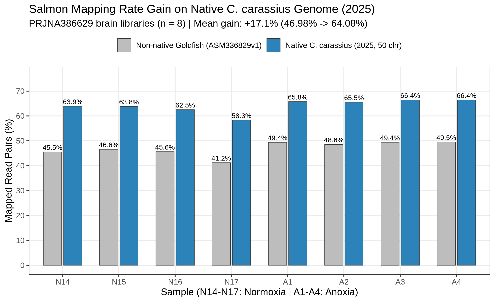
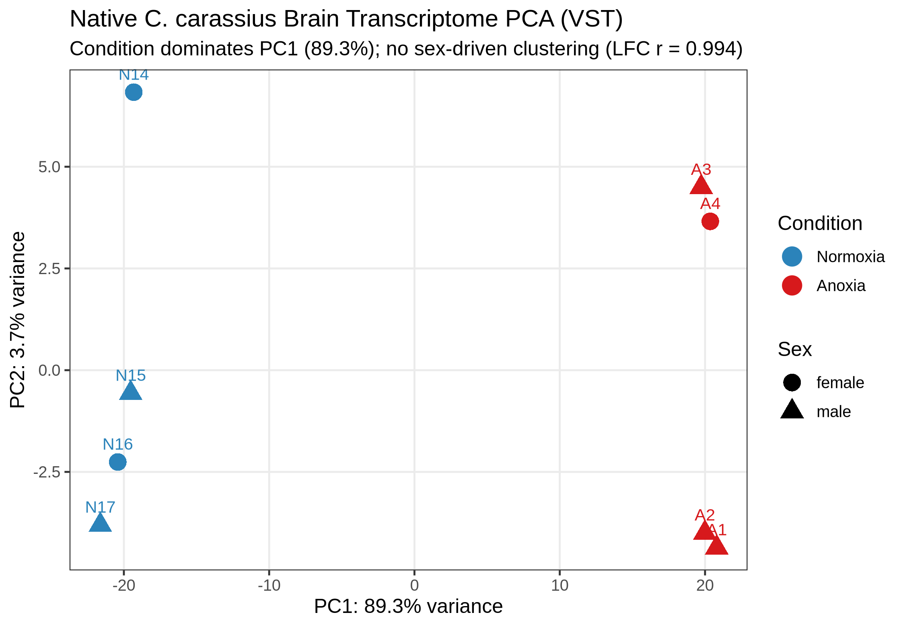
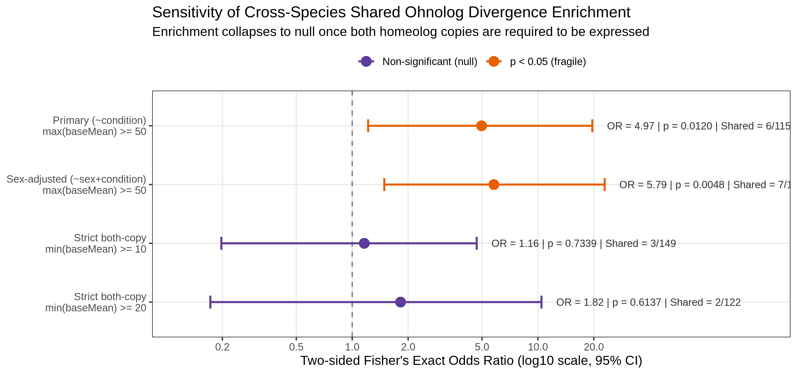

# Cyprinid Ohnolog Expression Divergence Under Hypoxia/Anoxia: A Native-Genome Audit

## Overview

Allotetraploid cyprinids—including common carp (*Cyprinus carpio*) and crucian carp (*Carassius carassius*)—share a lineage-specific whole-genome duplication (WGD) that produced two distinct subgenomes (A and B). This repository documents a comparative transcriptomics audit testing whether **ohnolog (homeolog) pairs exhibit conserved, shared expression divergence** in the brain under acute oxygen deprivation.

**Core Conclusion (Negative Result):** While preliminary cross-species mapping against a non-native goldfish reference suggested enrichment of shared ohnolog divergence (`n = 15` pairs), re-quantification on the **native chromosome-level *C. carassius* genome (2025)** combined with **100% genome-wide 1:1 protein RBH orthology** and **both-copy expression filtering** reveals that the apparent enrichment is driven by asymmetrically low/silent copies. Across actively co-expressed homeologs, expression responses to hypoxia/anoxia are predominantly **conserved (77%–81%)**, with no statistically significant cross-species enrichment of shared divergence (`p = 0.61–0.73`).

---

## Key Methodological Audits

1. **Native Genome Re-Quantification:** Transitioned *C. carassius* (`PRJNA386629`, Oslo wild population) to the native 2025 assembly (Valencia-Pesqueira et al., 2025; `doi:10.18710/GXMSUH`, 50 subgenome-assigned chromosomes `ccar_ua01–25` / `ccar_ub01–25`). Mean `Salmon v1.10.3` mapping rate jumped **+17.1%** (**46.98% → 64.08% ± 2.71%**; 100% ID match `82,383/82,383`).
2. **Sex Confounder & QC Control:** Adjusted for ENA sex metadata (`Normoxia`: 2F/2M; `Anoxia`: 1F/3M) via `~ sex + condition`. VST PCA separated conditions along **PC1 (89.3%)** with no sex clustering (`4,584` vs. `4,618` DEGs; Pearson `r = 0.99358`).
3. **100% Sequence-Verified Syntenic Quartets:** Genome-wide 1:1 protein RBH (`DIAMOND v2.2.9`, `e-value <= 1e-10`) identified **24,537** orthologs and validated **2,493 / 2,497 (99.84%)** opposite-subgenome syntenic quartets.
4. **Expression-Floor Sensitivity & Paired Interaction:** Tested `max(baseMean)` vs. `min(baseMean)` floors and fitted within-sample paired `Homeolog × Condition` models (`log2(A+1) - log2(B+1) ~ condition` and `~ sex + condition`).

---

## Statistical Summary (Native 2025 Genome)

| Analysis / Sensitivity Filter | Background | Co-Responsive | Shared Div | Carp Only | *C. carassius* Only | Both Cons | Fisher OR (95% CI) | *p*-value |
| :--- | :---: | :---: | :---: | :---: | :---: | :---: | :---: | :---: |
| **Primary (`~ condition`, `max baseMean >= 50`)** | 1,744 | 115 | 6 | 8 | 13 | 88 | 4.98 (1.22 – 19.64) | 0.01201 |
| **Sex-adjusted (`~ sex + condition`, `max baseMean >= 50`)** | 1,744 | 111 | 7 | 7 | 14 | 83 | 5.79 (1.49 – 22.89) | 0.00480 |
| **Strict both-copy (`min baseMean >= 10`)** | 1,983 | 149 | 3 | 17 | 17 | 112 | 1.16 (0.20 – 4.68) | **0.73393** |
| **Strict both-copy (`min baseMean >= 20`)** | 1,779 | 122 | 2 | 9 | 12 | 99 | 1.82 (0.17 – 10.45) | **0.61368** |

---

## Audit Figures

---

## Datasets & Software

- ***C. carassius* Brain RNA-seq:** `PRJNA386629` (Normoxia: `SRR5572569`, `SRR5572583`, `SRR5572549`, `SRR5572524`; Anoxia: `SRR5572553`, `SRR5572554`, `SRR5572562`, `SRR5572536`)
- ***C. carpio* Brain RNA-seq:** Control (`SRR18578462`, `SRR18578461`, `SRR18578450`) vs. Hypoxia (`SRR18578439`, `SRR18578438`, `SRR18578437`)
- **References:** *C. carassius* native assembly (Valencia-Pesqueira et al., 2025, `doi:10.18710/GXMSUH`); *C. carpio* Ensembl `ASM1834038v1`
- **Tools:** `Salmon v1.10.3`, `tximport`, `DESeq2`, `DIAMOND v2.2.9`, `ggplot2`, `Python 3`
